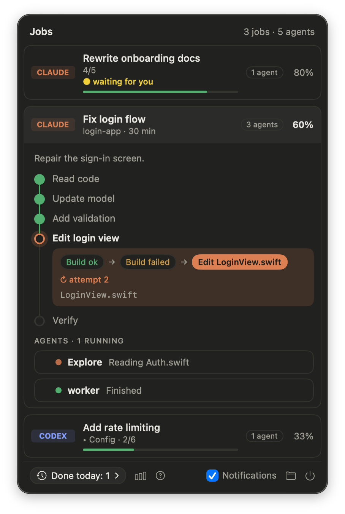
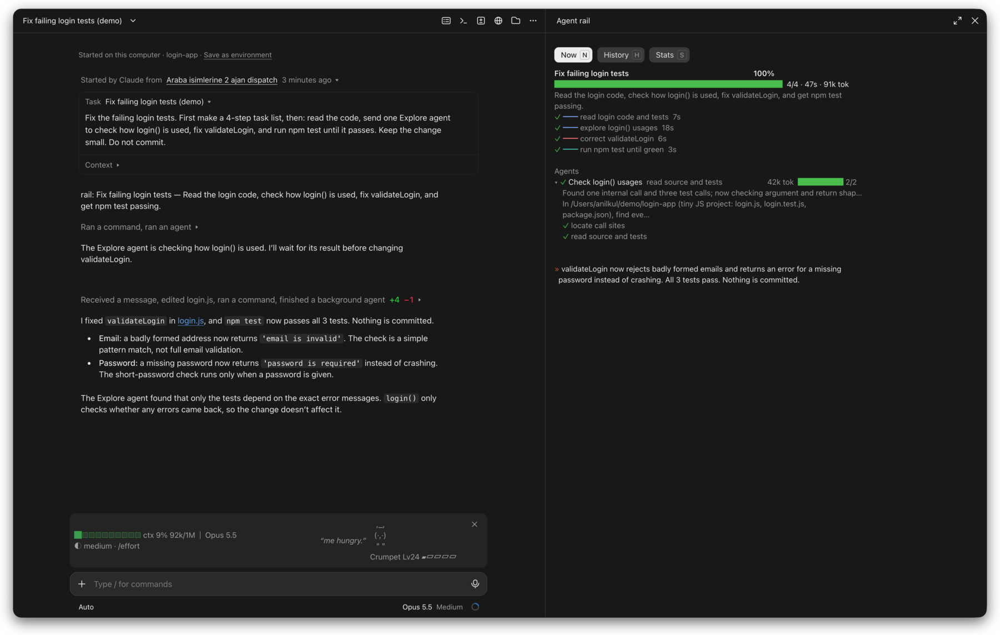
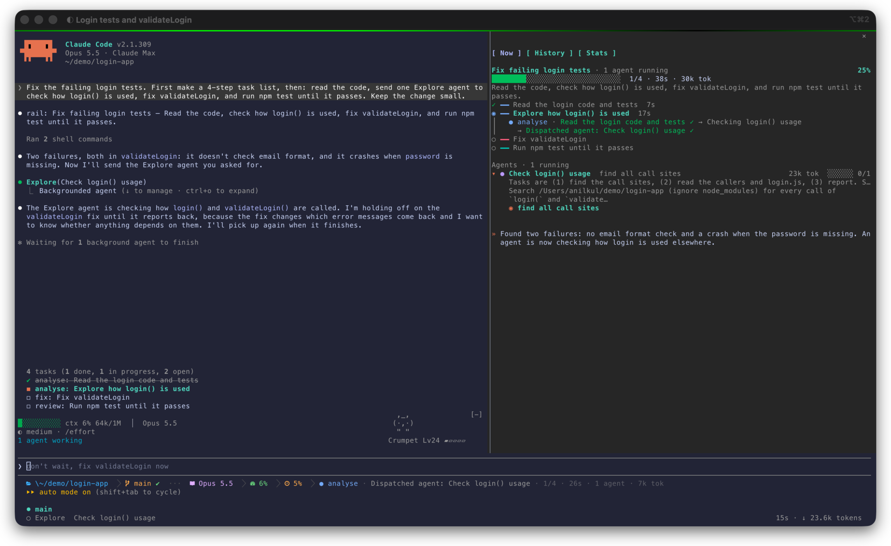
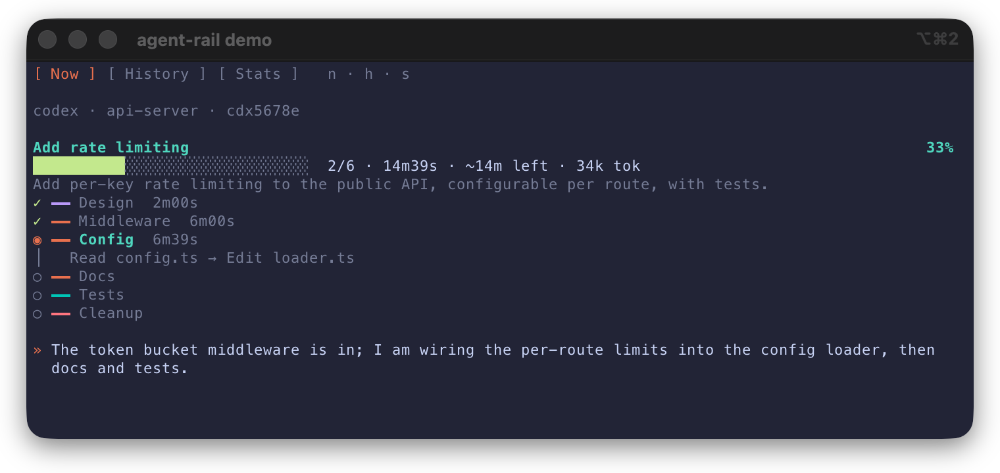

# agent-rail

A live rail for your Claude Code and Codex jobs: progress, milestones and the agents behind them.

<p align="center"></p>

## Claude Code

Needs Node 18 or later on PATH. In Claude Code (terminal or desktop app):

```
/plugin marketplace add Zenonix-Studio/agent-rail
/plugin install agent-rail@agent-rail
```

Restart Claude Code. Both the desktop app and the terminal get an **Agent rail** pane beside the chat (`/rail` toggles it), plus `/agent-rail:history` and, if you add it, the status line below.

The rail starts in **free** mode, which only watches. To have the agents report a plan and progress notes, open `/config` and set agent-rail's **Mode** to `railed` (see [Modes](#modes-free-and-railed)).

<p align="center">
  
  
</p>
<p align="center"><sub>The pane in the desktop app (left) and in the terminal (right)</sub></p>

## Modes: free and railed

The rail has two modes. **Free** is the default; pick one in `/config` under agent-rail's **Mode** (see [Switching](#switching) below).

**Free: watch only.** The plugin adds nothing to the conversation. It builds the rail from what the agents already do: each tool call becomes a step, its stage inferred from the tool (reading and searching is `analyse`, editing is `dev`, an edit after a failing build or test is `fix`, builds and tests are `review`), and agent rows show each subagent's own calls.

- You watch the agents as they would work without the plugin.
- Nothing for the agent to follow.
- The rail shows the steps already taken, not the ones still to come, so a job has no percentage. The title is the start of your prompt. In the desktop app, Claude's own plan still gives the full step list.

**Railed: the agents report to the rail.** The plugin's prompt hook asks the agent to start each new task with a `rail: <title> — <summary>` line, to lay out a 3–7 step plan with a stage on each step (`plan:`, `analyse:`, `dev:`, `fix:`, `review:`) and to add a one-sentence progress note as it goes. In the Claude desktop app and in Codex the plan goes in the agent's task list; in the Claude Code terminal, in a task list it already keeps, else in `plan:` and `step:` lines in its reply, so no extra tool calls are needed. Subagents write the same lines.

- A short title and summary written for the task.
- The whole plan up front: steps still to come, `2/4` and a percentage.
- Stages chosen by the agent, and progress notes in plain words.
- It adds a few lines to what the agent writes, so it is not the untouched flow. If you already keep your own task list or plan files, the two can overlap.

**Which one.** Railed helps the person watching, not the agent. In our tests (Claude Opus, 20 runs of two coding tasks scored by hidden checks) both modes scored the same every time. What railed adds is the view: you see the plan in the first minute and can stop a wrong one early, and you know how much is left. Use railed when you follow long jobs live; keep free when you let jobs run on their own, or want the agents untouched.

### Switching

In Claude Code (terminal and desktop app), pick the mode in the plugin's settings: `/config`, then agent-rail's **Mode**, `free` or `railed`. It is stored in `~/.claude/settings.json`:

```json
{
  "pluginConfigs": { "agent-rail@agent-rail": { "options": { "mode": "railed" } } }
}
```

The `AGENT_RAIL_MODE` environment variable, when set, overrides the setting: `"env": { "AGENT_RAIL_MODE": "railed" }` in `~/.claude/settings.json`, or for Codex, which has no plugin settings, in the shell that starts it: `AGENT_RAIL_MODE=railed codex`. Restart Claude Code or Codex after changing it.

## Menubar app

A native macOS menubar app that shows your running jobs. It reads the session files in `~/.agent-rail/sessions/*.json`.

- Local: it never writes to the state folder and sends nothing over the network.
- English and Turkish, following the system language.
- A card with no activity can be hidden (**Hide**), or its session stopped (**Stop session…**, right-click or under the expanded card). Stopping ends the whole Claude Code or Codex session and its agents, after a confirmation; it is offered only while the process the hooks last ran under is still that one (same pid and start time).

**Install:** download `AgentRail-<version>.dmg` from [Releases](https://github.com/Zenonix-Studio/agent-rail/releases), open it and drag AgentRail into Applications. It runs in the menubar (no Dock icon) and needs macOS 14 or later. Allow notifications when it asks, to hear when a job is done, needs you or is failing.

<details>
<summary>Build from source</summary>

Requirements: macOS 14+ and Xcode 26.

```sh
xcodebuild -project menubar/AgentRail.xcodeproj -scheme AgentRail \
  -destination 'platform=macOS' -derivedDataPath menubar/build build
```

Install it to get notifications (job done, needs you, failing). macOS only asks for notification permission for an app in an Applications folder; run from `menubar/build`, the request is denied without a prompt. Sign it with your own development team:

```sh
xcodebuild -project menubar/AgentRail.xcodeproj -scheme AgentRail \
  -destination 'platform=macOS' -derivedDataPath menubar/build build \
  DEVELOPMENT_TEAM=<your team id> CODE_SIGN_STYLE=Automatic CODE_SIGN_IDENTITY="Apple Development"
cp -R menubar/build/Build/Products/Debug/AgentRail.app ~/Applications/
open ~/Applications/AgentRail.app
```

If a denied prompt was recorded earlier, turn AgentRail on in System Settings > Notifications. `AgentRail.app/Contents/MacOS/AgentRail --notify-test` (via `open --args`) prints the permission state and posts a test notification.

Run against the sample state (written to a temp dir, so the working tree stays clean; quit any running copy first, since `open -n` starts a second instance):

```sh
node scripts/sample-state.mjs /tmp/agent-rail-sample
open -n --env AGENT_RAIL_HOME=/tmp/agent-rail-sample \
  menubar/build/Build/Products/Debug/AgentRail.app
```

The Xcode project is generated from `menubar/project.yml`. After changing it, regenerate with:

```sh
cd menubar && xcodegen generate
```

To pack a DMG: `scripts/release-menubar.sh --unsigned` for a local try, or with `DEVELOPER_ID` and `NOTARY_PROFILE` set for a signed, notarized one (the script prints the one-time setup).

</details>

## Web viewer

The same view in a browser, for Windows and Linux (it runs on macOS too). It reads the session files in `~/.agent-rail/sessions/*.json`, like the menubar app.

- Running jobs with their steps and agents, plus history, token stats and a legend of the stage colors.
- **Hide** a quiet card, or **Stop session…** to end a Claude Code or Codex session and its agents, after a confirmation.
- English and Turkish, following the browser language.
- Local: it listens on `127.0.0.1` only and answers no other host name.

**Run:** needs Node 18 or later. From a clone of this repository:

```
node web/server.mjs
```

Then open http://127.0.0.1:4317. Set `PORT` to use another port.

**Windows tray:** `web/tray.ps1` starts the viewer, opens it as a small window from the tray icon, and shows a notification when a job is done, needs you or is failing:

```
powershell -WindowStyle Hidden -ExecutionPolicy Bypass -File web\tray.ps1
```

## History command

`/agent-rail:history` lists the last 50 finished jobs across sessions, newest first, in the terminal and the desktop app. `/agent-rail:history <number>` shows one of them in full: its steps, agents and closing summary. The menubar's **Done today** button shows the same list. `/agent-rail:history stats`, the pane's **Stats** tab (`/rail stats`) and the menubar's chart button show the tokens spent since the weekly limit reset: the last 1, 3 and 5 days and the last 3, 10, 25 and 50 jobs.

## Codex

Codex has no pane, so the rail opens in a terminal split beside it. Set it up once:

```bash
git clone https://github.com/Zenonix-Studio/agent-rail ~/agent-rail
node ~/agent-rail/scripts/install-codex.mjs
```

Then, in a split beside Codex:

```bash
node ~/agent-rail/bin/agent-rail-watch.mjs
```

That is all: it follows the latest Codex session. As in the Claude pane, `n`, `h` and `s` switch between **Now**, **History** and **Stats**; `q` quits.

<p align="center"></p>


<details>
<summary>More</summary>

- Shortcut: the installer puts `rail` on PATH, the same command. Inside Codex, `$rail` opens it in a split in iTerm2, tmux, WezTerm or kitty (remote control on); elsewhere in a new Terminal window (the agent-rail hook opens it, outside the sandbox, so no approval is asked).
- Add `claude` for the latest Claude Code session instead, an id prefix for one session, `--agents` to expand every agent row.
- The installer adds the agent-rail hooks to `~/.codex/hooks.json` (backed up first, your own hooks kept), adds the `$rail` skill, and links `rail` into `~/.local/bin` (or the first writable folder of your PATH). Codex asks you to trust the new hooks on its next start.
- Steps need Codex's `update_plan` tool. The installer asks before turning it on in `~/.codex/config.toml` (`--yes` turns it on, `--no-plan` skips the question; with no terminal to ask in, it skips). If your config already has a `[tools]` section it only prints the line to add yourself: `[tools.update_plan]` with `enabled = true`.
- Codex jobs also show in the menubar, with their tokens (the main agent's and each subagent's).
- Undo it all: `node ~/agent-rail/scripts/uninstall-codex.mjs`.

</details>

## Status line

`bin/agent-rail-statusline.mjs` prints one line for the current session's job in Claude Code's status line: stage, current step, progress, elapsed time, time left (once a step has finished) and running agents.

```
● dev · Editing parser.mjs · 3/5 · 2m10s · ~4m left · 2 agents
```

Add it to your Claude Code settings (`~/.claude/settings.json`):

```json
"statusLine": {"type": "command", "command": "node <path>/bin/agent-rail-statusline.mjs"}
```

It prints nothing when the session has no job yet. Set `NO_COLOR` to drop the colors.

## Privacy

Everything stays on your machine; nothing is sent over the network. The hooks write one file per session to `~/.agent-rail/sessions/` (folder 0700, files 0600). Those files hold your prompts' text, job titles, step names, summaries, file names the agents touched and token counts. Files not written for 30 days are deleted. Collector errors go to `~/.agent-rail/collector.log`. Set `AGENT_RAIL_HOME` to keep them elsewhere.

## License

MIT, see [LICENSE](LICENSE).
